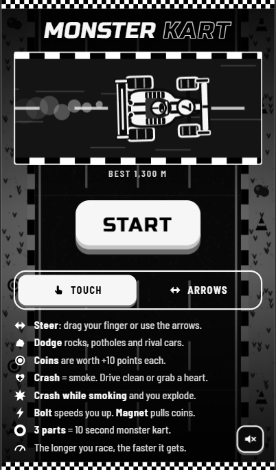

# 🎮 MONSTER KART

**MONSTER KART** is an endless, black-and-white kart racer built for portrait phones. Dodge rocks, potholes, and rival cars while collecting coins and hearts, then gather all three parts to transform into a monster kart.

🔗 **[Play the Game / Run Locally](#-getting-started-for-developers)**

---

## ✨ Key Features
* **Endless Racing:** Navigate a procedurally generated road with an always-open lane as the game gets faster.
* **Power-ups:** Collect coins, speed boosts, magnets, hearts, and three monster-kart parts.
* **Arcade Obstacles:** Dodge rocks, potholes, rival cars, smoke, and explosive hazards.
* **Portrait-First Controls:** Use touch drag, on-screen arrow buttons, or a keyboard.
* **Monster Transformation:** Assemble all three parts to activate the monster kart and clear the road.

---

## 🕹️ Controls

| Action | Keyboard | Touch |
| :--- | :--- | :--- |
| **Move** | `A` / `D` or Left / Right Arrow | Drag anywhere with the mouse (click and hold) |
| **Start** | `Enter` | Tap the start button |
| **Pause / Resume** | `Esc` or `P` | Tap the pause button |

---

## 🛠️ Built With
* **Engine / Framework:** HTML Canvas 2D and plain ES modules; no game framework or bundler
* **Art & Audio:** Canvas-rendered game art and synthesized Web Audio effects and music; Russo One and Barlow Semi Condensed fonts
* **Language:** JavaScript, HTML, and CSS; Node.js tooling and Playwright tests

---

## 🗺️ Roadmap
- [x] Endless racing, movement, and collision physics
- [x] Obstacles, pickups, and monster-kart transformation
- [x] Touch, on-screen arrow, and keyboard controls
- [x] PWA install and offline support
- [ ] Native Android and iOS releases
- [ ] Additional levels and polish

---

## 🤝 Credits & License
* **Developed by:** JHeroGR
* **Third-Party Assets:** Russo One and Barlow Semi Condensed fonts are from Google Fonts; no external game art or audio files are included
